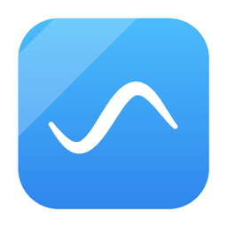
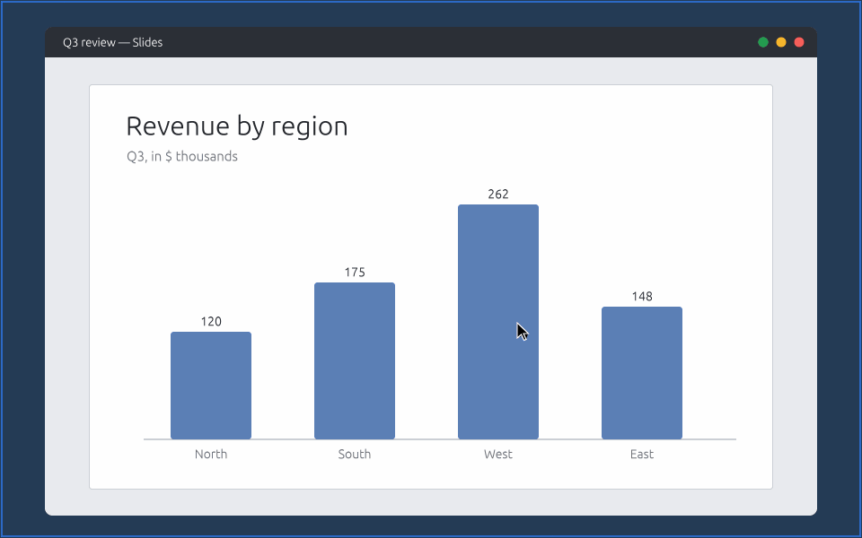

<p align="center"></p>

# Plexi

A light, fast notebook for handwriting and quick sketches that can also turn your whole
screen into a sheet of glass you draw on. Written in Rust.

- **Draw on screen.** Press <kbd>Ctrl</kbd>+<kbd>Alt</kbd>+<kbd>D</kbd> anywhere and the
  screen becomes your page: annotate a slide, circle a bug, sketch over a video call.
  Press <kbd>Esc</kbd> for click-through: your ink stays on top while you keep using the
  apps underneath. The same hotkey brings the pen back.
- **A pen that feels like a pen.** Pressure-sensitive ink drawn exactly where the pen
  goes, with light, adjustable smoothing that steadies slow strokes without rounding off
  fast writing.
- **An endless page.** Notes start on an infinite canvas in any paper color. Draw past
  the edge of a sheet and the next sheet's outline appears there; PDF export prints one
  sheet per outline, or shrinks everything onto one.
- **Snip, crop, style.** Snip any area of the screen into your notes
  (<kbd>Ctrl</kbd>+<kbd>Alt</kbd>+<kbd>S</kbd>, anywhere), crop pictures, and set text
  in any installed font, size, bold, italic or underline.
- **Type in your own handwriting.** Write a sample of each letter with the pen in the
  handwriting window (from the font picker, the File menu, or <kbd>Ctrl</kbd>+<kbd>K</kbd>);
  Plexi builds a real font from it that renders the same way in every export.
- **Record to video.** <kbd>Ctrl</kbd>+<kbd>Shift</kbd>+<kbd>R</kbd> records the canvas
  as you work, or the whole screen while you draw on it, to an MP4 in your Downloads
  folder (Windows). A trail behind the pointer shows where it is; its color, size and
  length are in Settings.
- **Animated GIFs play right on the canvas**, cropping and all; exports show their first
  frame like a still picture.
- **Almost no UI.** One floating toolbar. Everything else is a shortcut or
  <kbd>Ctrl</kbd>+<kbd>K</kbd> away.
- **Opens in a blink, saves on its own.** A single small exe; notes autosave and reopen
  where you left off. New versions are offered on launch and install with one click
  (checked against the release's checksums; turn it off in Settings).
- **Exports to everything:** PDF (vector, multi-page), PNG, JPEG, WebP, BMP, TIFF, SVG,
  HTML, Markdown with images, plain text, Excalidraw, draw.io, InkML and JSON, with a live
  preview and your choice of paper size, orientation, margins and pixel size. Export or
  print just some sheets (<kbd>Ctrl</kbd>+<kbd>P</kbd>, then e.g. `1, 3, 5-7`), or just
  the part you selected, wherever the sheet outlines are.

<p align="center"></p>

## Download

Grab the latest build from [Releases](https://github.com/HaydenHarms/plexi/releases):

| File | What it is |
| --- | --- |
| `Plexi-x.y.z-setup.exe` | The normal installer. No admin needed. Start menu entries, `.plexi` file association, optional "start with Windows". |
| `Plexi-x.y.z-portable.exe` | Nothing to install. Keeps its settings and autosaves in a `PlexiData` folder next to the exe. |
| `Plexi-x.y.z-portable.zip` | The portable build in a folder (handy for USB sticks). |
| `Plexi-x.y.z-x64.msi` | All-users MSI for managed PCs. |
| `Plexi-x.y.z-macos.dmg` | macOS 11+ (Apple silicon and Intel). Open it and drag Plexi to Applications. |
| `Plexi-x.y.z-macos.zip` | The same Mac app, zipped. |

Builds are not code-signed yet, so Windows SmartScreen may warn the first time
(**More info → Run anyway**). On a Mac, right-click Plexi → **Open** the first time, and
allow Screen Recording if you want screenshots from draw-on-screen mode. On macOS the
hotkeys are <kbd>Control</kbd>+<kbd>Option</kbd>+<kbd>D</kbd> / <kbd>X</kbd> / <kbd>N</kbd> / <kbd>S</kbd>,
and draw-on-screen covers the main display.

## Using it

| | |
| --- | --- |
| Draw on screen / click-through | <kbd>Ctrl</kbd>+<kbd>Alt</kbd>+<kbd>D</kbd> (anywhere), <kbd>Esc</kbd> |
| Clear screen ink | <kbd>Ctrl</kbd>+<kbd>Alt</kbd>+<kbd>X</kbd> (anywhere), <kbd>C</kbd> |
| Back to the notebook | <kbd>Ctrl</kbd>+<kbd>Alt</kbd>+<kbd>N</kbd> (anywhere), <kbd>N</kbd> |
| Snip an area → page + clipboard | <kbd>Ctrl</kbd>+<kbd>Alt</kbd>+<kbd>S</kbd> (anywhere), or the scissors button |
| Screenshot with ink → clipboard | <kbd>Ctrl</kbd>+<kbd>Shift</kbd>+<kbd>C</kbd> while drawing on screen |
| Record to video | <kbd>Ctrl</kbd>+<kbd>Shift</kbd>+<kbd>R</kbd> or the record button: the canvas in the notebook, the whole screen while drawing on it; again to stop |
| Pen, highlighter, eraser | <kbd>P</kbd> <kbd>H</kbd> <kbd>E</kbd>, or middle-drag / pen barrel button to erase |
| Select (lasso), rectangle select, text | <kbd>S</kbd> <kbd>M</kbd> <kbd>T</kbd>; double-click text to edit it; font, size and style in the bar under the toolbar; <kbd>Shift</kbd>+click or drag adds or removes elements from the selection |
| Hand | <kbd>G</kbd>; drag empty canvas to pan, drag an element to grab and move it, drag a handle to resize, click empty canvas to deselect, <kbd>Shift</kbd>+click to select several |
| Snapshot | pick it from the select tools button, then drag a box: that part of the page goes to the clipboard as a picture |
| Copy, paste | <kbd>Ctrl</kbd>+<kbd>C</kbd> <kbd>Ctrl</kbd>+<kbd>V</kbd> |
| Line, arrow, rectangle, ellipse | <kbd>L</kbd> <kbd>A</kbd> <kbd>R</kbd> <kbd>O</kbd> (hold <kbd>Shift</kbd> to snap) |
| Colors, width | <kbd>1</kbd>–<kbd>9</kbd>, <kbd>[</kbd> <kbd>]</kbd> |
| Pan, zoom | <kbd>G</kbd>+drag, right-drag, <kbd>Space</kbd>+drag, <kbd>Shift</kbd>+scroll, two fingers · scroll wheel, pinch |
| Pages | <kbd>Ctrl</kbd>+<kbd>Enter</kbd> new, <kbd>PgDn</kbd> / <kbd>PgUp</kbd>, trash button to delete (undoable) |
| Images | paste or drop; drag a corner to resize freely (<kbd>Shift</kbd>: keep proportions) |
| Text boxes | drag a corner to scale the text, font size and all; drag the handle on either side to set a wrap width (with the select, hand or text tool) |
| Crop or lock an image, arrange, paper color, sheet outlines and numbers | right-click |
| Export, print | <kbd>Ctrl</kbd>+<kbd>E</kbd> or <kbd>Ctrl</kbd>+<kbd>P</kbd>: pick sheets, or with something selected just that part, then **Print…** opens the PDF to print |
| Everything else | <kbd>Ctrl</kbd>+<kbd>K</kbd> command palette, <kbd>F1</kbd> shortcuts |

Paste or drop images straight onto a page. The tray icon (left-click) toggles drawing on
screen. Hotkeys can be changed in Settings (<kbd>Ctrl</kbd>+<kbd>,</kbd>).

### Command line

```
plexi [notes.plexi]          open a notebook
plexi --draw                 start drawing on screen
plexi --background           start hidden, waiting for the hotkey
plexi export notes.plexi notes.pdf [--page N | --all | --screen] [--scale 2] [--no-background]
                                   [--paper letter [--landscape] [--tile]] [--trim] [--margin 0.5]
                                   [--sheets 1,3,5-7]
```

## The `.plexi` file

A zip you can open with any archive tool:

- `document.json` — pages, ink (`[x, y, pressure, …]` per stroke), text, shapes
- `assets/` — pasted images, stored as-is
- `thumbnail.png` — a preview of the first page

Coordinates are CSS pixels (1/96 inch), so a Letter page is 816 × 1056.

## Building

```
cargo run -p plexi                 # the app
cargo test --workspace
cargo run -p plexi-core --example demo -- demo.plexi   # a sample notebook
```

- `crates/plexi-core` — document model, ink geometry, file format and every exporter
  (no UI, fully tested headless)
- `crates/plexi` — the egui app: canvas, overlay mode, tray and hotkeys
- `installer/` — Inno Setup and WiX definitions used by the release workflow

Releases: bump `version` in the root `Cargo.toml`, then push a tag `vX.Y.Z`.
`.github/workflows/release.yml` builds and publishes the installer, MSI and portable builds.

## License

Copyright (c) 2026 Hayden Harms. All rights reserved. See [LICENSE](LICENSE).
