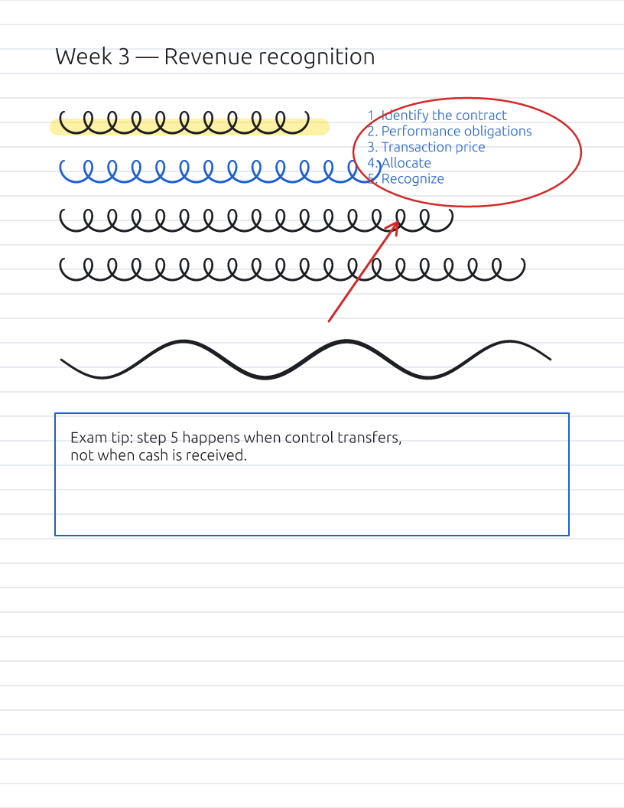

<p align="center"></p>

# Plexi

A light, fast notebook for handwriting and quick sketches that can also turn your whole
screen into a sheet of glass you draw on. Written in Rust.

- **Draw on screen.** Press <kbd>Ctrl</kbd>+<kbd>Alt</kbd>+<kbd>D</kbd> anywhere and the
  screen becomes your page: annotate a slide, circle a bug, sketch over a video call.
  Press <kbd>Esc</kbd> for click-through: your ink stays on top while you keep using the
  apps underneath. The same hotkey brings the pen back.
- **A pen that feels like a pen.** Pressure-sensitive ink drawn exactly where the pen
  goes, with light, adjustable smoothing that steadies slow strokes without rounding off
  fast writing.
- **Almost no UI.** One floating toolbar. Everything else is a shortcut or
  <kbd>Ctrl</kbd>+<kbd>K</kbd> away.
- **Opens in a blink, saves on its own.** A single small exe; notes autosave and reopen
  where you left off.
- **Exports to everything:** PDF (vector, multi-page), PNG, JPEG, WebP, BMP, TIFF, SVG,
  HTML, Markdown with images, plain text, Excalidraw, draw.io, InkML and JSON.

<p align="center"></p>

## Download

Grab the latest build from [Releases](https://github.com/HaydenHarms/plexi/releases):

| File | What it is |
| --- | --- |
| `Plexi-x.y.z-setup.exe` | The normal installer. No admin needed. Start menu entries, `.plexi` file association, optional "start with Windows". |
| `Plexi-x.y.z-portable.exe` | Nothing to install. Keeps its settings and autosaves in a `PlexiData` folder next to the exe. |
| `Plexi-x.y.z-portable.zip` | The portable build in a folder (handy for USB sticks). |
| `Plexi-x.y.z-x64.msi` | All-users MSI for managed PCs. |

Builds are not code-signed yet, so SmartScreen may warn the first time
(**More info → Run anyway**).

## Using it

| | |
| --- | --- |
| Draw on screen / click-through | <kbd>Ctrl</kbd>+<kbd>Alt</kbd>+<kbd>D</kbd> (anywhere), <kbd>Esc</kbd> |
| Clear screen ink | <kbd>Ctrl</kbd>+<kbd>Alt</kbd>+<kbd>X</kbd> (anywhere), <kbd>C</kbd> |
| Back to the notebook | <kbd>Ctrl</kbd>+<kbd>Alt</kbd>+<kbd>N</kbd> (anywhere), <kbd>N</kbd> |
| Screenshot with ink → clipboard | <kbd>Ctrl</kbd>+<kbd>Shift</kbd>+<kbd>C</kbd> while drawing on screen |
| Pen, highlighter, eraser | <kbd>P</kbd> <kbd>H</kbd> <kbd>E</kbd>, or right-drag / pen barrel button to erase |
| Select (lasso), text | <kbd>S</kbd> <kbd>T</kbd> |
| Line, arrow, rectangle, ellipse | <kbd>L</kbd> <kbd>A</kbd> <kbd>R</kbd> <kbd>O</kbd> (hold <kbd>Shift</kbd> to snap) |
| Colors, width | <kbd>1</kbd>–<kbd>9</kbd>, <kbd>[</kbd> <kbd>]</kbd> |
| Pan, zoom | scroll, <kbd>Space</kbd>+drag, two fingers · <kbd>Ctrl</kbd>+scroll, pinch |
| Pages | <kbd>Ctrl</kbd>+<kbd>Enter</kbd> new, <kbd>PgDn</kbd> / <kbd>PgUp</kbd> |
| Everything else | <kbd>Ctrl</kbd>+<kbd>K</kbd> command palette, <kbd>F1</kbd> shortcuts |

Paste or drop images straight onto a page. The tray icon (left-click) toggles drawing on
screen. Hotkeys can be changed in Settings (<kbd>Ctrl</kbd>+<kbd>,</kbd>).

### Command line

```
plexi [notes.plexi]          open a notebook
plexi --draw                 start drawing on screen
plexi --background           start hidden, waiting for the hotkey
plexi export notes.plexi notes.pdf [--page N | --all | --screen] [--scale 2] [--no-background]
```

## The `.plexi` file

A zip you can open with any archive tool:

- `document.json` — pages, ink (`[x, y, pressure, …]` per stroke), text, shapes
- `assets/` — pasted images, stored as-is
- `thumbnail.png` — a preview of the first page

Coordinates are CSS pixels (1/96 inch), so a Letter page is 816 × 1056.

## Building

```
cargo run -p plexi                 # the app
cargo test --workspace
cargo run -p plexi-core --example demo -- demo.plexi   # a sample notebook
```

- `crates/plexi-core` — document model, ink geometry, file format and every exporter
  (no UI, fully tested headless)
- `crates/plexi` — the egui app: canvas, overlay mode, tray and hotkeys
- `installer/` — Inno Setup and WiX definitions used by the release workflow

Releases: bump `version` in the root `Cargo.toml`, then push a tag `vX.Y.Z`.
`.github/workflows/release.yml` builds and publishes the installer, MSI and portable builds.

## License

MIT
